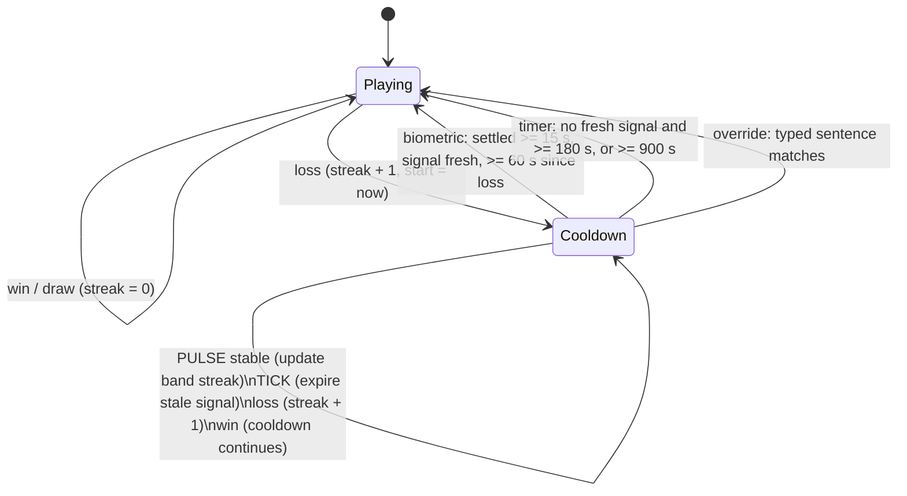
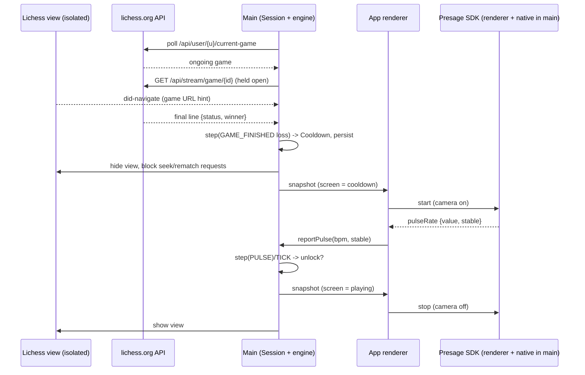

# Architecture

Zwischenzug is one Electron window with two surfaces: our own UI (consent, check-in, side
panel, cooldown screen) and Lichess in an isolated `WebContentsView`. The main process owns
all state and the lock. The renderer runs the camera (the Presage renderer SDK requires it)
and only reports readings.

## Folder structure

```text
src/
  core/            Pure TypeScript. No Electron, no Node built-ins (enforced by ESLint).
    clock.ts         Steady clock: wall-clock epoch advanced by a monotonic timer
    config.ts        Config type, defaults, resolveConfig(file, env)
    cooldown.ts      Cooldown state machine (step), unlock rule, derived view
    export.ts        Game log -> CSV
    persisted.ts     Validating parsers for state.json / games.json
    lichess-game.ts  Lichess game JSON -> win/loss/draw/ignored/ongoing for a user
    identity.ts      Lichess sign-in: parse /account/info, decide whether play is allowed
    lichess-url.ts   lichess.org URL checks, game id from URL
    lock-rules.ts    Which Lichess requests to cancel while locked
    ndjson.ts        Incremental NDJSON splitter
    pulse.ts         Median / baseline from calibration readings; diagnostics reading stats
  shared/          Types and the IPC contract shared by main, preload and renderer
    types.ts, ipc.ts
  main/            Electron main process
    index.ts         Composition root: wires everything by hand (no DI framework)
    window.ts        App BrowserWindow, camera permission policy
    session.ts       Session: profile, engine state, game log; single source of truth
    store.ts         JsonFile: atomic JSON persistence
    config.ts        Loads config file + env (.env in dev)
    secrets.ts       Presage key: env var, else safeStorage-encrypted file
    presage.ts       Loads the SmartSpectra native SDK, bindSmartSpectraIpc
    ipc.ts           ipcMain handlers with sender validation
    game-source.ts   GameSource interface (adapter #2)
    lichess/
      source.ts      LichessGameSource: poll + per-game stream + export fallback
      view.ts        Lichess WebContentsView: own session, no preload, nav guard
      identity.ts    Who is signed in to the embedded session (session.fetch + cookie watch)
      lock.ts        webRequest blocker for the Lichess session
    log.ts           electron-log
    smoke.ts         Scripted verification mode (ZZ_SMOKE_DIR; Chromium fake camera, never
                     the real one)
  preload/index.ts  contextBridge: window.zz (typed ZzApi) + the SDK's preload bridge
  renderer/         App UI, plain TypeScript + DOM (no framework)
    main.ts          Screen router driven by main's AppSnapshot
    biometrics/
      provider.ts    BiometricProvider interface (adapter #1)
      presage.ts     PresageProvider (SmartSpectra renderer SDK)
    views/           consent, setup, calibration, panel, cooldown, api-key, diagnostics;
                     unlock-path.ts picks the path the cooldown shows (pulse / waiting /
                     timer) and why
tests/             Vitest unit tests + real Lichess payload fixtures
  renderer/          Renderer tests with a fake SDK (type-checked with the web config)
scripts/build.mjs  esbuild bundles for main / preload / renderer
scripts/presage-key-check.mjs  Key check with the main-process SDK and blank frames
build/             macOS entitlements for electron-builder
```

## Module contracts

| Module                | Contract                                                                                                                                                                               |
| --------------------- | -------------------------------------------------------------------------------------------------------------------------------------------------------------------------------------- |
| `core/cooldown`       | `step(state, event, rules) -> { state, unlock }`. Pure; events carry their own timestamp. `unlockReason(cooldown, now, rules)` is the unlock rule.                                     |
| `core/lichess-game`   | `parseGame(json, username, now) -> ongoing / ignored / finished(FinishedGame) / null`. Accepts export JSON (`status: "mate"`) and stream JSON (`status: {id, name}`).                  |
| `Session`             | Methods mirror user and system intents (`giveConsent`, `gameFinished`, `pulse`, `tick`, `override`, `deleteAll`...). Persists, then emits change; `snapshot()` is what the UI renders. |
| `GameSource`          | `start(username)`, `stop()`, `noteUrl(url)`; calls `finished(game)` and `status(...)`. May report a game twice; `Session` dedupes by game id.                                          |
| `BiometricProvider`   | `start({reading, state, stream})`, `stop()`. Readings carry `stable`. State is `starting`, `measuring{ok, hint}` or `unavailable{reason}`.                                             |
| IPC (`shared/ipc.ts`) | `ZzApi` is the whole renderer-to-main surface. Every handler validates the sender frame and argument types.                                                                            |

Only two interfaces exist, because a second implementation is planned for both:
`BiometricProvider` (other rPPG engines) and `GameSource` (Chess.com). The cooldown strategy is
a pure function plus config, not an interface.

## Cooldown state machine



Screens are derived from profile + engine state, never stored:
`consent` (no consent) -> `setup` (no username) -> `cooldown` (engine locked; wins over
everything else) -> `diagnostics` (opened by the user; in memory only, closed by any engine
phase change) -> `calibration` (camera mode without a baseline, or recalibrating) -> `playing`.

Engine time comes from a steady clock (`core/clock.ts`): epoch milliseconds advanced by
`performance.now()` and re-anchored to the wall clock when the computer wakes
(`powerMonitor` `resume`). Changing the system clock while the app runs therefore neither
ends nor extends a cooldown.

Unlock rule details (`core/cooldown.ts`):

- Settled = stable reading <= baseline + max(`toleranceBpm`, baseline x `tolerancePct`%).
  Lower than baseline counts as settled.
- Unstable readings (SDK `stable=false`, or validation not OK) neither count nor reset the
  streak. If only unstable readings arrive, the signal goes stale after `signalTimeoutSec`
  and the streak resets.
- The first stable reading in a cooldown is logged as "pulse at loss".
- Five losses in a row add a suggested (not enforced) 30-minute pause.

## Event and data flow



## Lichess detection and lock (chosen approach)

**Detection** uses only public, unauthenticated endpoints, verified live on 2026-11-07:

1. `GET /api/user/{username}/current-game` every 10 s returns the ongoing game, or the last
   game played. Ongoing games are delayed by three moves for anti-cheat.
2. For a game seen in progress (from the poll, or from one `GET /game/export/{id}` when the
   embedded page opens a game URL), hold `GET /api/stream/game/{id}` open. The last line is
   the finished game with `status: {id, name}` and `winner`, then the stream closes. Polling
   continues while streams are open (they may belong to correspondence games).
3. If a stream closes without a result, or both stream slots are taken, check
   `GET /game/export/{id}` for that exact game (backing off to once a minute) until it ends,
   because `current-game` may already show the user's next game.
4. Only games seen in progress count, plus `current-game`'s last game if it ended within
   10 minutes (an app restart right after a loss). A stream replays an old game from a
   first line without a status, so opening a past game in the view never counts.
5. On HTTP 429, wait 60 s, as Lichess documents. Network errors back off and set the status.

Rejected: `POST /api/stream/games-by-users` only streams games where **both** players are in
the list. `GET /api/stream/event` needs an OAuth token; it is the upgrade path if the
public endpoints prove unreliable. Reading the board from the page DOM was rejected for
fair-play reasons and fragility.

**Lock** has two layers during a cooldown (only the second while the sign-in is unverified):

1. The Lichess view is hidden (`setVisible(false)`) whenever the screen is not `playing`. The
   cooldown screen covers the whole window, so there is nothing to click or type into. This
   does not depend on Lichess's markup.
2. While locked or unverified, `session.webRequest.onBeforeRequest` on the Lichess partition cancels
   `POST /setup/hook|friend|ai`, challenge accept/create, tournament/swiss join, board seek,
   `*/rematch`, and new `wss://*.lichess.org/lobby/socket*` and `/play/*` sockets. Verified:
   a seek POST and a lobby socket opened from inside the Lichess page both failed while
   locked, and an ordinary GET still worked.

**Sign-in check.** Detection watches the configured account's public feed, so a game played
logged out, or as another account, would never be seen. Play is therefore only allowed while
the embedded Lichess session is verified as the configured account (`core/identity.ts`,
`main/lichess/identity.ts`):

- Main calls `GET https://lichess.org/account/info` (`Accept: application/json`) with
  `session.fetch` on the Lichess partition, so the request carries that session's own cookies.
  No password, no token. Verified live from Electron: logged out it returns
  `401 {"error":"Login required"}`. Logged in it returns `200 {id, username, ...}` (lila
  `Account.info`, the old mobile app's endpoint). From curl the same URL gets a Cloudflare
  challenge; from Electron's network stack it does not. `/api/account` was rejected: it
  ignores session cookies (`401 Missing authorization header`).
- `cache: 'no-store'` is required: Lichess sends `Cache-Control: private, max-age=20`, and a
  probe showed `session.fetch` otherwise answers from the HTTP cache, which could outlive a
  logout.
- Re-checked every 60 s, after every Lichess navigation, and 10 s after an error. A change of
  the login session id inside the `lila2` cookie (absent while logged out; seen live: only
  `sid`) immediately sets the state to "checking" (blocked) and re-checks, so signing out or
  switching accounts cannot race the next check. Stale answers are discarded by sequence number.
- Anything other than a verified match (checking, signed out, another account, HTTP error,
  network error) blocks play through the request lock below. The Lichess view stays visible
  so the user can sign in and browse; a bar above it says "Sign in to Lichess as @username to
  play" and opens the sign-in page. Usernames compare case-insensitively. The cooldown timer
  and override are unaffected. Verified live (logged out): seek POST and lobby socket
  cancelled, ordinary GET 200, sign-in page reachable.
- OAuth PKCE was considered: it proves who authorized a token once, not who is signed in to
  the embedded session later, so it would not catch an account switch. Not used.

CSS injection was considered and rejected as the primary mechanism: pairing, challenges and
rematches also happen through URLs, socket messages and page features CSS cannot reliably
cover, and selectors break when Lichess changes its markup.

**Known gaps:** a pairing click inside the detection latency (sub-second to a few seconds);
already-open sockets are not closed; quitting the app or using another browser bypasses
everything; Lichess can rename routes (affects layer 2 only).

## Presage integration

The official Electron integration (from the SDK repo's `electron-quickstart`) is followed:

- Main: `bindSmartSpectraIpc(appWindow)` from `@smartspectra/node-sdk/main`. It loads the
  native C ABI runtime via koffi, accepts the MessagePort only from the app window's
  `webContents`, and runs one native session per connection.
- Preload: our preload imports `@smartspectra/node-sdk/preload`, which exposes
  `window.__smartspectraBridge`. It is bundled into our sandboxed preload, which only needs
  `require('electron')`.
- Renderer: `SmartSpectraSDK` from `@smartspectra/node-sdk/renderer` calls `getUserMedia`,
  pumps frames to main through the bridge, and emits `validationStatus`, `metrics`,
  `error` and `streamAvailable`.
- Options: `requestedMetrics: [MetricType.PULSE_RATE]`, `enableTelemetry: false` (configurable),
  no LLM insights. `decodeMetrics(buf).cardio.pulseRate[]` gives `{value, stable, confidence,
timestamp}`; `stable` means confidence >= 40 (about +/-3 bpm, per the SDK's protobuf docs).
- Errors (`kAuthenticationFailed`, `kCreditExhausted`, `kNetworkError`, `kInputUnavailable`,
  the SDK's 30 s startup watchdog `kProcessingFailed`, ...), getUserMedia failures, a missing
  key, a camera denial or a failed native load all become `unavailable(reason)`. The provider
  then stops the SDK (camera off), the UI says so and the engine's timer fallback applies.
- Observed with a bogus key (main-process SDK, blank frames): `start()` blocks about 2-5 s,
  then `error` code 2 `kAuthenticationFailed` (retryable=false) and status `kError`.
- The SDK's preload bridge is a single shared MessagePort. `PresageProvider` chains
  teardowns (stop, then destroy) and a new session waits for the previous one, because a
  late `destroy()` would close the new session's port. Callbacks from an older session are
  ignored. Covered by `tests/renderer/presage-provider.test.ts`.
- Diagnostics screen: environment facts from main (`getDiagnostics`: key source only, OS
  camera status without prompting, SDK/Electron version, dev or packaged) plus a live session
  whose raw readings stay in that view.
- Packaging: the native closure ships as `resources/smartspectra` (outside asar), and
  `SMARTSPECTRA_CAPI_PATH` is set unconditionally in packaged builds.

Trade-off: the renderer SDK sends the API key to main as part of its `configure` message, so
the key must be in the app renderer's memory while measuring. Main hands it out only to the
app page, and only in camera mode. The Lichess view cannot reach `window.zz` or the SDK bridge
(verified).

## Security model

| Concern            | Measure                                                                                                                                                                                                                     |
| ------------------ | --------------------------------------------------------------------------------------------------------------------------------------------------------------------------------------------------------------------------- |
| Renderer isolation | `contextIsolation`, `sandbox`, `nodeIntegration: false`, `webviewTag: false`, `app.enableSandbox()`                                                                                                                         |
| Lichess content    | Separate `WebContentsView`, persistent partition `persist:lichess`, **no preload**, all permission requests and checks denied, DevTools disabled, keyboard focus moved to the app page while hidden                         |
| Instances          | `requestSingleInstanceLock` per data folder, so two instances never write the same state files                                                                                                                              |
| Navigation         | Lichess: top-level navigation and redirects allowed only to https `lichess.org`/`*.lichess.org`; other links open in the system browser; popups denied (Lichess popups load in place). App window: no navigation, no popups |
| IPC                | Single typed `ZzApi` via `contextBridge`; handlers check `senderFrame.url` is our bundled page and coerce argument types                                                                                                    |
| CSP                | `default-src 'none'`; scripts/styles self only; `worker-src blob:` (SDK requirement); `media-src blob: mediastream:`                                                                                                        |
| Camera             | Permission handler grants `media` only if video-only, from our `file://` page, and after camera-mode consent. Main also gates `requestCamera` and the API key on consent                                                    |
| Credentials        | `PRESAGE_API_KEY` env or safeStorage-encrypted file; `.env` loaded only in dev and ignored by git                                                                                                                           |
| Persistence        | Atomic writes (temp + rename), mode 0600; corrupt files quarantined; a damaged cooldown restores as locked                                                                                                                  |
| Logging            | electron-log to the OS log folder; no pulse values or keys are logged                                                                                                                                                       |

## Persistence and restart

`state.json`: `{ version, profile: {consent, username, baseline}, engine }`.
`games.json`: `{ version, games: GameLogEntry[] }`. Both live in the app data folder.

An active cooldown is written on entry, keeps its original `startedAt` across restarts, and
drops any pre-restart signal (`settledSince`, `lastValidAt`), so a restart never shortens it.
Closing the app longer than the fallback time is treated as a valid pause (the timer rule
applies on return). A start time in the future (clock moved back while closed) restarts the
cooldown at launch, so it still ends by the maximum.

Each `games.json` entry records `consecutiveLosses` after that game (absent in entries logged
before it existed). On a finished game the state file is written before the log.

## Decisions (ADR-style)

1. **Electron + esbuild, not electron-forge/vite.** The Presage sample uses electron-builder +
   esbuild; three small esbuild bundles keep the toolchain minimal. Electron is pinned to
   43.2.0, the version the official sample pins.
2. **Main owns the lock.** The renderer can only report readings and request an override;
   it cannot unlock by itself. Restarting the renderer or app does not reset state.
3. **Renderer-side SDK.** This is Presage's recommended Electron path. Main-process capture
   (`useCamera`) exists but is documented as less suitable for Electron.
4. **Public Lichess API, no OAuth.** No token to store or leak. Polling plus per-game streams
   give fast detection within Lichess's limits (one poll per 10 s; at most two streams).
5. **Hide the view instead of injecting CSS.** Deterministic and independent of Lichess's
   markup. Request blocking is a second layer, not the primary one.
6. **Two adapters only** (`BiometricProvider`, `GameSource`); everything else is concrete.
   Constructor injection by hand in `main/index.ts`.
7. **No UI framework.** Five small screens with a 20-line `h()` helper; text is always set
   via text nodes (no `innerHTML`).
8. **electron-log** for structured file and console logging; small and Electron-aware.
9. **Upper-bound band only.** Pulse below baseline counts as settled. The goal is "not
   elevated", not "match exactly".

## Verified vs planned

| Area                                                    | Status               | Evidence                                                                                                                             |
| ------------------------------------------------------- | -------------------- | ------------------------------------------------------------------------------------------------------------------------------------ |
| Secure shell, isolated Lichess view                     | Verified             | Smoke run: Lichess loads; `window.zz` and the SDK bridge are undefined in Lichess and present in the app page                        |
| Consent -> username -> playing; restart                 | Verified             | Scripted UI run; state persisted; relaunch lands on `playing`                                                                        |
| Cooldown engine + unlock rule                           | Verified (unit)      | 23 tests in `tests/cooldown.test.ts`                                                                                                 |
| Loss detection from live Lichess                        | Verified             | Real finished game detected as a loss within ~1 s of launch; a live session showed 6 consecutive real games detected from the stream |
| Lock layer 1 (hide view) + layer 2 (request block)      | Verified             | View hidden while locked; seek POST and lobby socket from the Lichess page failed; a GET succeeded                                   |
| Sign-in check, logged out                               | Verified             | Smoke run on live lichess.org: `signed-out`; seek POST and lobby socket cancelled; GET 200; sign-in button opened `/login`           |
| Sign-in check, logged in / wrong account                | Verified (unit)      | `tests/identity.test.ts`; logged-in live check is a manual test (docs/MANUAL_TESTS.md)                                               |
| Override, game log, delete-all, refusal during cooldown | Verified             | Scripted UI runs; `games.json` contents checked                                                                                      |
| Restart during cooldown                                 | Verified             | Countdown continued across relaunch (0:32 -> 0:24)                                                                                   |
| Timer fallback without key/SDK                          | Verified (UI + unit) | Cooldown screen states the fallback; engine tests                                                                                    |
| Presage SDK native load + IPC bind (dev + packaged)     | Verified             | `SmartSpectra SDK loaded and bound` on darwin-arm64, also from the packaged `.app`                                                   |
| Unsigned macOS package                                  | Verified             | `npm run dist:dir` -> `release/mac-arm64/Zwischenzug.app`                                                                            |
| Bad key -> `kAuthenticationFailed`                      | Verified (SDK)       | `npm run presage:check` with a bogus key; same mapping unit-tested in the provider                                                   |
| Provider teardown order, camera release on SDK error    | Verified (unit)      | `tests/renderer/presage-provider.test.ts` (fails on the previous code)                                                               |
| Diagnostics screen (no key)                             | Verified             | Smoke run: SDK 3.4.0 loaded, key "no", camera "not-determined", FALLBACK label, Start disabled                                       |
| Steady clock, future start clamp                        | Verified (unit)      | `tests/clock.test.ts`, `tests/persisted.test.ts`                                                                                     |
| Single instance                                         | Verified             | Second launch on the same data folder exited; the first kept its cooldown                                                            |
| Timer unlock, refusals, override, restart (Phase 2)     | Verified             | Smoke runs on a seeded cooldown; `games.json` shows `timer` / `override` with durations                                              |
| Log export                                              | Verified (unit)      | `tests/export.test.ts`; the save dialog itself was not driven                                                                        |
| Presage live pulse, validation hints, real errors       | **Not verified**     | Needs an API key and a camera session (docs/MANUAL_TESTS.md)                                                                         |
| Calibration end to end                                  | **Not verified**     | Depends on the above                                                                                                                 |
| Camera permission denial path                           | **Not verified**     | Code path exists (`systemPreferences`); needs System Settings                                                                        |
| Signed / notarized DMG                                  | Not done             | Needs an Apple Developer identity                                                                                                    |
| Chess.com `GameSource`, breathing visual                | Planned              | See the implementation plan                                                                                                          |
