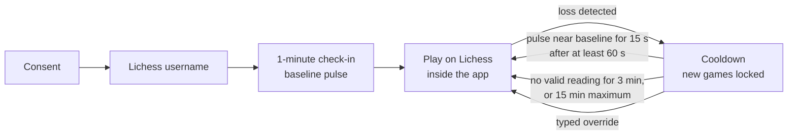

<div align="center">


# Zwischenzug

**After a Lichess loss, your next game unlocks when your pulse is back near your baseline.**

A privacy-first tilt cooldown for online chess. macOS desktop app built with Electron,
TypeScript, the Presage SmartSpectra SDK and the Lichess open API.

[](LICENSE)


</div>

You play Lichess inside Zwischenzug. When you lose, new games are locked. With your consent,
the app reads your pulse from the webcam, on-device, and unlocks once it has settled back near
your own baseline. No usable camera signal? A timer unlocks instead. You can always skip a
cooldown by typing a confirmation sentence.

The camera is **never on while you play**: only during a one-minute check-in and on the
cooldown screen after a loss.

> Zwischenzug is a habit tool, not a medical device. It does not diagnose, treat or monitor
> any condition, and it does not claim to detect "tilt". It only compares your current pulse
> reading with your own baseline.

## Problem and motivation

Online chess makes the next game one click away. After a painful loss, the impulsive requeue
("one more to win it back") is where losing streaks start. Willpower is weakest exactly then,
so Zwischenzug puts a short, physiological pause between the loss and the next game: not a
fixed penalty, but "wait until you have actually calmed down", with a timer as the floor and a
ceiling. The time floors (one minute, and a suggested 30-minute break after five losses in a
row) follow [romanbreyten/chess-tilt](https://github.com/romanbreyten/chess-tilt).

## How it works



1. **Check-in**: one minute of pulse readings sets your personal baseline (median of stable
   readings).
2. **Loss detection**: the app follows your Lichess public game stream and notices a finished
   game within seconds.
3. **Lock**: the Lichess view is replaced by the cooldown screen; requests that would start a
   new game (seeks, challenges, rematches) are blocked at the network layer as a second layer.
4. **Unlock**: when your pulse stays within baseline + max(5 bpm, 7%) for 15 s, after a
   60 s minimum. Without a valid reading for 3 minutes the timer unlocks; 15 minutes is the hard
   maximum. All thresholds are configurable.

## Key features

- **Pulse-gated cooldown** after every loss, with a live bpm readout against your band.
- **Timer fallback** that always works: timer-only mode, no key, no face, poor light.
- **Escape hatch**: skip any cooldown by typing a sentence (logged as an override).
- **Sign-in guard**: games stay blocked until the embedded Lichess session is confirmed to be
  the account you chose, so you cannot play on a second account inside the app.
- **Escalation**: after five losses in a row, suggests a longer break.
- **Local game log** with CSV/JSON export, and **Delete all my data** in one click.
- **Diagnostics** screen: SDK status, key present, camera permission, live raw readings.

## Screenshots


| Consent                                           | Check-in                                      |
| ------------------------------------------------- | --------------------------------------------- |
|           |  |
| **Cooldown, timer fallback (no face)**            | **Side panel**                                |
|  |      |

More in [docs/screenshots/](docs/screenshots/). The pulse-path cooldowns
(`cooldown-recovering`, `cooldown-pulse`, `cooldown-waiting`), `panel.png` and
`panel-settings.png` are **simulated**: real renderer views fed crafted app states, with a
placeholder camera image. The others are scripted runs of the app with a temporary profile.
The Lichess area is empty in all of them because the embedded lichess.org view is captured
separately.

## Demo video

_Coming soon._

## Architecture

Three processes with a narrow, typed IPC surface: the **main process** owns state, the
cooldown engine, the Lichess watcher and the request lock; the sandboxed **app renderer** runs
the UI and the SmartSpectra SDK; **Lichess** runs in a separate, permission-less
`WebContentsView`. Pure logic (cooldown engine, parsing, persistence) lives in `src/core/` and
is unit-tested without Electron. See [ARCHITECTURE.md](ARCHITECTURE.md) for the design, the
security model and what is verified.

## Tech stack

Electron 43 · TypeScript (strict) · esbuild · Vitest · ESLint + Prettier · Presage SmartSpectra
Node SDK 3.4 · Lichess API · electron-builder · electron-log

## Requirements

- macOS on Apple Silicon (the only platform tested)
- Node.js >= 22.12
- A webcam
- A [Presage API key](https://physiology.presagetech.com) (optional: without one, cooldowns use
  the timer)
- A Lichess account

## Install and setup

```bash
git clone https://github.com/CodewithJha/zwischenzug.git
cd zwischenzug
npm install
npm run app      # builds release/mac-arm64/Zwischenzug.app and opens it
```

`npm install` downloads the SmartSpectra native runtime for every supported platform (a few
hundred MB). `package.json#allowScripts` approves the install scripts that are needed. If npm
skipped the Electron download, run `node node_modules/electron/install.js`.

First run: choose **Allow camera between games** or **Timer only**, enter your Lichess
username, do the one-minute check-in, then sign in to Lichess in the left pane and play.

### Presage API key

1. Create an account at <https://physiology.presagetech.com> and copy your API key.
2. Either:
   - **Packaged app**: paste it under **Settings** in the side panel (or on the check-in
     screen). It is encrypted with the macOS keychain (Electron `safeStorage`) and stored in the
     app's data folder.
   - **Development**: `cp .env.example .env` and set `PRESAGE_API_KEY=...`. `.env` is git-ignored,
     read only by dev runs, and wins over a saved key.
3. `npm run presage:check` confirms Presage accepts the key without the camera (blank frames for
   about 20 s; the key is never printed).

Zwischenzug requests only `PULSE_RATE`. If your key is not provisioned for it, the app shows the
SDK error and falls back to the timer.

## Development

| Command                 | What it does                                                      |
| ----------------------- | ----------------------------------------------------------------- |
| `npm run dev`           | Build and run from source (as "Zwischenzug", see below)           |
| `npm run dev:raw`       | Build and run with the stock Electron app                         |
| `npm run check`         | Typecheck + lint + format check + unit tests                      |
| `npm test`              | Vitest unit tests                                                 |
| `npm run build`         | Bundle main, preload and renderer into `dist/` with esbuild       |
| `npm run dist:dir`      | Unsigned, unpacked macOS app in `release/`                        |
| `npm run dist:mac`      | macOS arm64 DMG (needs a signing identity for distribution)       |
| `npm run app`           | `dist:dir`, then open the app                                     |
| `npm run icon`          | Regenerate `build/icon.png` and `icon.icns` from `build/icon.svg` |
| `npm run presage:check` | Check the Presage key from env/`.env` without a camera            |

`npm run dev` launches a renamed copy of Electron.app (`.scratch/Zwischenzug.app`, an APFS
clone re-signed ad hoc) so the Dock, menu bar and app switcher say Zwischenzug. macOS treats it
as its own app: it asks for camera access once, and again whenever the copy is rebuilt after an
Electron or icon change; a Presage key saved in the app may trigger a one-time keychain prompt.

Tuning defaults live in [`src/core/config.ts`](src/core/config.ts) and can be overridden with
environment variables (see [.env.example](.env.example)) or a `zwischenzug.config.json` in the
app data folder. Use `ZZ_USER_DATA_DIR=/tmp/zz-profile` for a throwaway profile. Steps that
need a key, a camera or a person are in [docs/MANUAL_TESTS.md](docs/MANUAL_TESTS.md).

## Privacy: consent and data handling

- **Consent first.** Nothing uses the camera until you choose "Allow camera between games".
  "Timer only" never touches it.
- **Camera only between games**: during the check-in, on the cooldown screen and on the
  diagnostics screen when you start a measurement. The app page is the only page allowed to
  request it (video only). Lichess gets no device permissions.
- **On-device processing.** The SmartSpectra SDK estimates pulse on this computer. No video or
  frames are uploaded or saved. Presage's servers are contacted to validate the API key and
  record usage (device pairing and usage verification), never with video. SDK telemetry is off.
- **Stored locally** (`~/Library/Application Support/Zwischenzug/`): consent choice, Lichess
  username, baseline pulse, and a game log (result, losses in a row, baseline, first pulse
  after the loss, time to unlock, unlock reason). Pulse values are not written to the log file.
- **Network**: lichess.org (the site, its public API to detect finished games, and
  `/account/info` with the embedded session's cookies to check who is signed in) and Presage's
  key and usage checks. Nothing else. Zwischenzug never sees your Lichess password.
- **Delete all my data** (side panel) removes the game log, baseline, username and consent,
  damaged copies of those files, the saved Presage key, the diagnostic log files and the
  embedded Lichess session (you are signed out). It is unavailable during an active cooldown.
  It keeps your own `zwischenzug.config.json`, a fresh empty state file, Chromium's cache for
  the app window (no personal data) and `PRESAGE_API_KEY` if set in the environment.
- **Export** (CSV or JSON) happens only when you ask, to a file you choose.

## Limitations

- **Self-control, not enforcement.** You can quit the app and play in a browser or on your
  phone. The lock makes the impulsive requeue harder; it cannot make it impossible. Moving the
  system clock forward while the app is closed shortens a cooldown.
- **Live pulse not yet verified end to end** on a real face (needs a key and a camera session;
  see [docs/MANUAL_TESTS.md](docs/MANUAL_TESTS.md)). The SDK loads, binds and rejects a bad
  key as expected; the timer path is fully verified.
- **Starting the camera pauses the app** for about 2-5 s while the SDK session starts, and
  quitting during a measurement waits up to 10 s for it to stop.
- **Detection latency.** A rematch clicked faster than Lichess reports the game end (sub-second
  to a few seconds) can still go through.
- **Lichess internals.** The request-blocking layer depends on Lichess URL paths that can
  change; the primary lock (hiding the Lichess view) does not. If the sign-in check endpoint
  changes, play stays blocked (fail closed).
- **Lichess only**, macOS Apple Silicon only. The breathing guide is a fixed pace, not a
  measurement.
- **Dev environment**: if launched from a VS Code or Cursor terminal, `ELECTRON_RUN_AS_NODE`
  may be set; `npm run dev` clears it, other Electron commands need
  `env -u ELECTRON_RUN_AS_NODE`.

**Not medical advice.** Zwischenzug is not a medical device and its readings are estimates.
Do not use it to make health decisions.

## Hackathon

Built solo for the [Presage SmartSpectra SDK Challenge 2026 on DEV](https://dev.to/challenges/presage-2026-11-04).

## Acknowledgements

- [Presage Technologies](https://physiology.presagetech.com) for the SmartSpectra SDK
  (`@smartspectra/node-sdk`), integrated following its Electron quickstart.
- [Lichess](https://lichess.org) and its [open API](https://lichess.org/api).
- Fonts under the SIL Open Font License 1.1 (licenses in `src/renderer/fonts/`):
  [Schibsted Grotesk](https://github.com/schibsted/schibsted-grotesk) and
  [Martian Mono](https://github.com/evilmartians/mono).
- [romanbreyten/chess-tilt](https://github.com/romanbreyten/chess-tilt) for the research behind
  the time floors.

## License

Zwischenzug's own source code is [MIT](LICENSE). The Presage SmartSpectra SDK is not part of
this repository: it is installed from npm and is proprietary software of Presage Technologies,
used under [Presage's Terms of Service](https://physiology.presagetech.com/tos). Packaged builds
include it under those terms. Fonts are under the SIL OFL 1.1.
