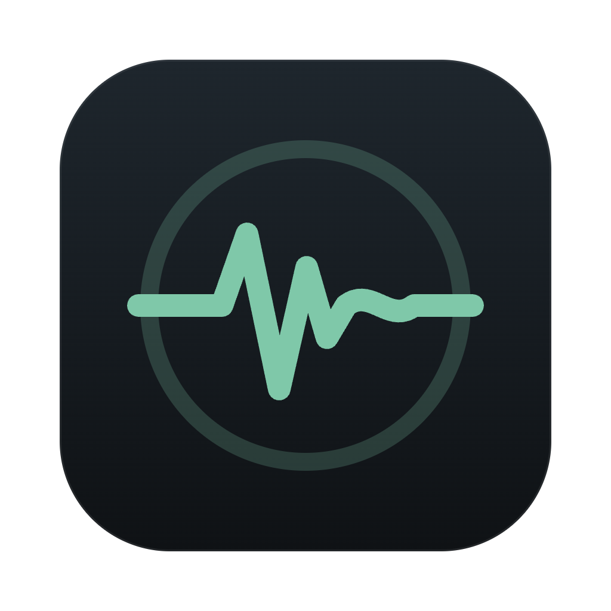
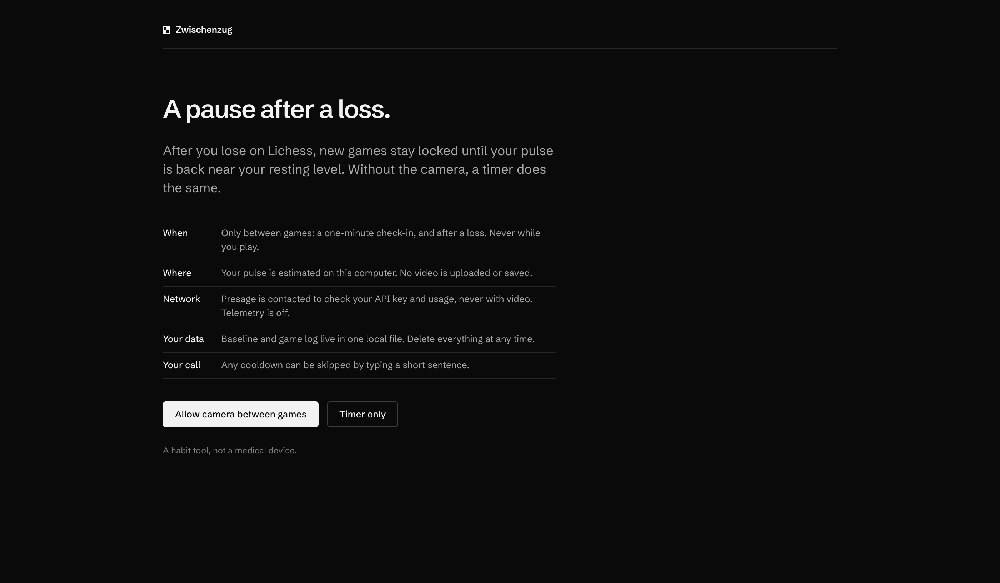
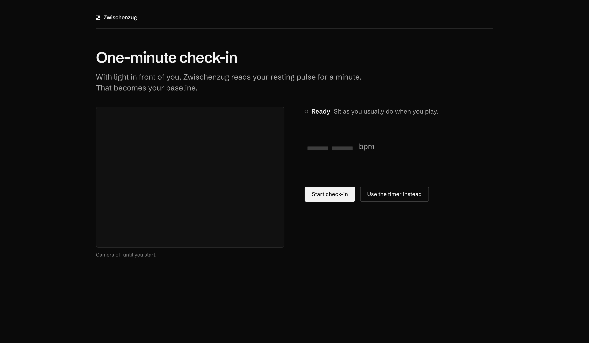
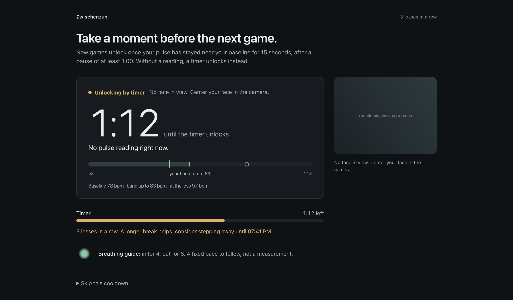
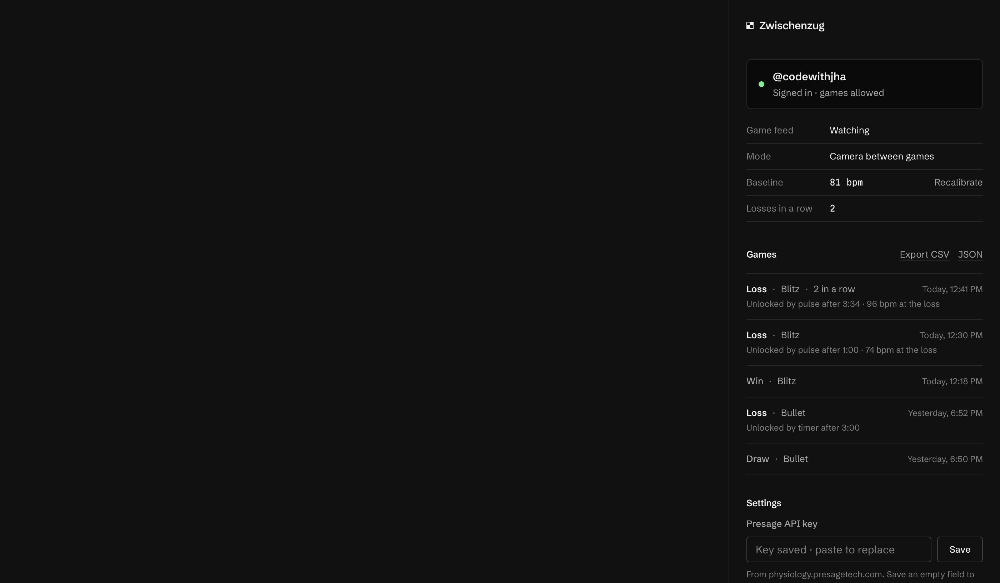

<div align="center">



# Zwischenzug

**After a Lichess loss, your next game unlocks when your pulse is back near your baseline.**

A privacy-first tilt cooldown for online chess: a desktop app for macOS (and Windows) built with Electron,
TypeScript, the Presage SmartSpectra SDK and the Lichess open API.

[](https://github.com/CodewithJha/zwischenzug/actions/workflows/ci.yml)
[](LICENSE)


</div>

You play Lichess inside Zwischenzug. When you lose, new games are locked. With your consent,
the app reads your pulse from the webcam, on your own computer, and unlocks once it has stayed
near your personal baseline. No usable camera signal? A timer unlocks instead. You can always
skip a cooldown by typing a confirmation sentence.

The camera is **never on while you play**: only during a one-minute check-in and on the
cooldown screen after a loss.

> Zwischenzug is a habit tool, not a medical device. It does not diagnose, treat or monitor
> any condition, and it does not claim to detect "tilt". It only compares your current pulse
> reading with your own baseline.

## Contents

[Problem](#the-problem) · [How it works](#how-it-works) · [Presage SmartSpectra](#how-presage-smartspectra-is-used) ·
[Features](#key-features) · [Screenshots](#screenshots) · [Architecture](#architecture) ·
[Setup](#install-and-setup) · [Testing](#testing-and-verification) · [Privacy](#privacy-consent-and-data-handling) ·
[Limitations](#limitations) · [Hackathon](#hackathon)

## The problem

Online chess puts the next game one click away. After a painful loss, the impulsive requeue
("one more to win it back") is where losing streaks start.

An analysis of 11.3 million Lichess games with player fixed effects
([romanbreyten/chess-tilt](https://github.com/romanbreyten/chess-tilt)) found that players
perform about **7 rating points below their usual level in the game after a loss**, and about
**24 points below after five losses in a row**; a **30-minute break removes the effect**. In
blitz, **56% of games after five straight losses are followed by a new game within a minute**.
The author notes the data cannot separate emotional tilt from simply having an off day.

Neither Lichess nor chess.com has a built-in cooldown. Existing helpers are browser extensions
that count losses and block play for a fixed time, whether or not you have actually calmed down.

## How it works

Zwischenzug puts a short pause between a loss and the next game. Instead of a fixed penalty,
the pause ends when your pulse is back near your own baseline, with a timer as the floor and a
hard maximum as the ceiling.

<p align="center">
  
</p>

1. **Consent.** Choose "Allow camera between games" or "Timer only". Nothing runs before this.
2. **Check-in.** One minute of webcam readings sets your baseline (median of stable readings).
3. **Play.** Lichess runs inside the app. The camera is off. Play is only allowed while the
   embedded Lichess session is signed in as the account you chose.
4. **Loss detected.** The app watches your account through the Lichess public API and notices
   a finished game within seconds.
5. **Lock.** The Lichess view is hidden and requests that would start a new game (seeks,
   challenges, rematches, lobby sockets) are cancelled at the network layer.
6. **Unlock**, whichever comes first:
   - **Pulse**: at or below baseline + max(5 bpm, 7%) for 15 s, after at least 60 s.
   - **Timer**: no valid reading for 180 s (timer-only mode, no face, poor light, SDK error).
   - **Override**: type the confirmation sentence (logged as an override).
   - **Cap**: 15 minutes after the loss, always.
7. **Escalation.** After five losses in a row the app suggests a 30-minute break.

Defaults live in [`src/core/config.ts`](src/core/config.ts) and can be overridden for development.

## How Presage SmartSpectra is used

<p align="center">
  
</p>

The camera signal decides when you may play again; it is not a decorative readout.

- The **SmartSpectra Node SDK** (`@smartspectra/node-sdk` 3.4) estimates pulse from the webcam
  on this computer. Its native runtime is loaded in the Electron main process and bound to the
  sandboxed app page through a narrow preload bridge, following Presage's Electron quickstart.
- Zwischenzug requests only **`PULSE_RATE`** and uses the SDK's stability and validation
  signals. Unstable readings never settle a cooldown; a reading older than 5 s counts as no
  reading; values outside 30-220 bpm are ignored.
- **Calibration** takes the median of stable readings over one minute and needs at least 10.
- SDK hints such as "too dark" or "no face" are shown to the user and switch the cooldown to the
  timer path with the reason. After a retryable failure the measurement restarts (up to 5 times,
  15 s apart), so the pulse path resumes when you sit back in view.
- Video never leaves the machine. The SDK contacts Presage's servers only to validate the key
  and record usage; telemetry is off.

## Key features

- **Pulse-gated cooldown** after every loss, with a live bpm readout against your band.
- **Timer fallback** that always works: timer-only mode, no key, no face, poor light.
- **Escape hatch**: skip any cooldown by typing a sentence (logged as an override).
- **Sign-in guard**: games stay blocked until the embedded Lichess session is confirmed as the
  account you chose, so a second account or anonymous play inside the app cannot get around it.
- **Survives restarts**: the cooldown and its start time are saved (with a backup copy), so
  quitting and relaunching does not reset or end it.
- **Escalation** after five losses in a row.
- **Local game log** with CSV/JSON export, and **Delete all my data** in one click.
- **Diagnostics** (Settings > Advanced): SDK status, camera permission, live raw readings.

## Screenshots


| Consent                                           | Check-in                                      |
| ------------------------------------------------- | --------------------------------------------- |
|           |  |
| **Cooldown, timer fallback (no face)**            | **Side panel**                                |
|  |      |

More in [docs/screenshots/](docs/screenshots/).

- **Simulated:** `cooldown-recovering`, `cooldown-pulse`, `cooldown-waiting`, `panel` and
  `panel-settings` are the real renderer views fed crafted app states, with a placeholder camera
  image. The pulse values in them are not real measurements.
- **Scripted runs:** the other screenshots are the app running with a temporary profile.
- The Lichess area is empty in all of them because the embedded lichess.org view is captured
  separately.

## Demo video

> **Placeholder.** The demo video has not been published yet; a link will be added here.

## Architecture

<p align="center">
  
</p>

- The **main process** owns all state: the cooldown engine, the Lichess watcher, the sign-in
  check, the request lock and local storage. It is the single source of truth for the lock.
- The sandboxed **app renderer** runs the UI and the SmartSpectra provider, and talks to main
  through a small typed IPC surface with sender validation.
- **Lichess** runs in a separate `WebContentsView` with its own session, no preload and no
  device permissions, restricted to lichess.org.
- Pure logic (engine, parsing, persistence, unlock rules) lives in `src/core/` and is
  unit-tested without Electron.

<p align="center">
  
</p>

See [ARCHITECTURE.md](ARCHITECTURE.md) for the module layout, state machine, security model and
design decisions.

## Tech stack

Electron 43 · TypeScript (strict) · esbuild · Vitest · ESLint + Prettier · Presage SmartSpectra
Node SDK 3.4 · Lichess API · electron-builder · electron-log. No UI framework; plain HTML/CSS
with design tokens and self-hosted OFL fonts.

## Download

Prebuilt apps are attached to the
[latest release](https://github.com/CodewithJha/zwischenzug/releases/latest):

| Platform              | File                                      | Status                                                                                                          |
| --------------------- | ----------------------------------------- | --------------------------------------------------------------------------------------------------------------- |
| macOS (Apple Silicon) | `Zwischenzug-<version>-arm64.dmg`         | Main platform, tested with a real webcam and real games                                                         |
| Windows 10/11 (x64)   | `Zwischenzug-<version>-win-x64-setup.exe` | Built and launch-checked on CI (app starts, SDK loads, Lichess reachable); camera use not yet tested on Windows |

Both are unsigned builds from a solo hackathon project, so the OS warns on first launch.

### macOS

1. Open the DMG and drag **Zwischenzug** to **Applications**.
2. The app is not notarized (no Apple Developer ID), so macOS blocks the first launch. Either
   open **System Settings › Privacy & Security** and click **Open Anyway** next to the
   Zwischenzug message, or run:
   ```bash
   xattr -dr com.apple.quarantine /Applications/Zwischenzug.app
   ```
3. Launch it, choose **Allow camera between games**, enter your Lichess username, paste your
   Presage API key on the check-in screen, and allow camera access when macOS asks.

### Windows

1. Run the installer. It installs for the current user, no admin needed.
2. The installer is not code-signed, so Microsoft Defender SmartScreen shows "Windows protected
   your PC": click **More info**, then **Run anyway**.
3. Launch Zwischenzug from the Start menu and follow the same first-run steps. If no camera
   image appears, check **Settings › Privacy & security › Camera** and allow desktop apps to
   use the camera.

## How judges can test

You need a free [Lichess account](https://lichess.org/signup) and, for the pulse path, a free
[Presage API key](https://physiology.presagetech.com/auth/register). There are no shared test
credentials: the key is tied to a personal free trial, and Lichess sign-in happens inside the
app on lichess.org itself.

- **See the live Presage signal in about a minute (no game needed):** choose "Allow camera
  between games", enter your Lichess username, paste the key and click **Start check-in**: the
  one-minute check-in measures your pulse live and saves your baseline. Afterwards,
  **Settings › Advanced › Pulse diagnostics** in the side panel shows raw live readings, the
  SDK's status and hints, and the reading rate.
- **Full loop:** sign in to Lichess in the left pane as the same username, start a casual game
  and resign. New games lock and the cooldown screen shows your
  live pulse against your baseline. It unlocks by pulse after at least 60 s; cover the camera to
  see the timer fallback; or use **Skip cooldown** and type the sentence.
- **Without a key:** choose **Timer only**. Every cooldown then unlocks by timer (180 s).
- Good front lighting on your face gives the most stable readings.

## Install and setup

To build from source instead of using the DMG:

**Requirements:** macOS on Apple Silicon (the only platform tested), Node.js >= 22.12, a webcam,
a Lichess account and, for the pulse path, a [Presage API key](https://physiology.presagetech.com).
Without a key every cooldown uses the timer.

```bash
git clone https://github.com/CodewithJha/zwischenzug.git
cd zwischenzug
npm install
npm run app      # builds release/mac-arm64/Zwischenzug.app and opens it
```

`npm install` downloads the SmartSpectra native runtime (a few hundred MB).
`package.json#allowScripts` approves the install scripts that are needed. If npm skipped the
Electron download, run `node node_modules/electron/install.js`.

First run: choose **Allow camera between games** or **Timer only**, enter your Lichess username,
do the one-minute check-in, then sign in to Lichess in the left pane and play.

### Presage API key

1. Create an account at <https://physiology.presagetech.com> and copy your API key.
2. Either:
   - **Packaged app**: paste it under **Settings** in the side panel (or on the check-in
     screen). It is encrypted with the macOS keychain (Electron `safeStorage`).
   - **Development**: `cp .env.example .env` and set `PRESAGE_API_KEY=...`. `.env` is
     git-ignored and read only by dev runs.
3. `npm run presage:check` confirms Presage accepts the key without the camera (blank frames for
   about 20 s; the key is never printed).

### Signing and Gatekeeper

The released DMG and local builds (`npm run app`, `npm run dist:dir`, `npm run dist:mac` with
`CSC_IDENTITY_AUTO_DISCOVERY=false`) are **ad hoc signed, not Developer ID signed and not
notarized**. The packaged app has Electron fuses hardened (no `ELECTRON_RUN_AS_NODE`, no
`NODE_OPTIONS`, no `--inspect`, asar integrity on) and is configured for the hardened runtime,
which applies once it is signed with a Developer ID. A downloaded copy is blocked by Gatekeeper
until you allow it (see [Download](#download)).

## Development

| Command                 | What it does                                                                  |
| ----------------------- | ----------------------------------------------------------------------------- |
| `npm run dev`           | Build and run from source (shown as "Zwischenzug", see below)                 |
| `npm run dev:raw`       | Build and run with the stock Electron app                                     |
| `npm run check`         | Typecheck + lint + format check + unit tests                                  |
| `npm test`              | Vitest unit tests                                                             |
| `npm run build`         | Bundle main, preload and renderer into `dist/` with esbuild                   |
| `npm run dist:dir`      | Unsigned, unpacked macOS app in `release/`                                    |
| `npm run dist:mac`      | macOS arm64 DMG (needs a signing identity for distribution)                   |
| `npm run dist:win`      | Windows x64 NSIS installer (built on Windows; see the Windows build workflow) |
| `npm run app`           | `dist:dir`, then open the app                                                 |
| `npm run icon`          | Regenerate `build/icon.png` and `icon.icns` from `build/icon.svg`             |
| `npm run presage:check` | Check the Presage key from env/`.env` without a camera                        |

`npm run dev` launches a renamed copy of Electron.app (`.scratch/Zwischenzug.app`, an APFS clone
re-signed ad hoc) so the Dock, menu bar and app switcher say Zwischenzug. macOS asks for camera
access once for it, and again when the copy is rebuilt after an Electron or icon change.

Tuning defaults can be overridden in development with environment variables (see
[.env.example](.env.example)) or a `zwischenzug.config.json` in the app data folder; packaged
builds ignore the development-only variables. Use `ZZ_USER_DATA_DIR=/tmp/zz-profile` for a
throwaway profile.

## Testing and verification

Three kinds of evidence, kept separate. The full matrix is in
[ARCHITECTURE.md](ARCHITECTURE.md#verified-vs-planned).

**Automated** (`npm run check`, also run by [CI](.github/workflows/ci.yml) on macOS):
189 Vitest unit tests in 19 files covering the cooldown engine and unlock rules, Lichess result
parsing and loss detection, the sign-in decision, persistence and recovery from damaged files,
the steady clock, CSV/JSON export, the Presage provider's teardown and retry, the quit guard and
UI formatting. CI also builds the app and the unsigned macOS package.

**Scripted runs** (local, temporary profiles, a local fake Lichess server and Chromium's fake
camera; no real games): loss to lock to timer unlock, override, restart during a cooldown,
recovery from a truncated state file, Delete all, logged-out play blocked on real lichess.org,
opening an old game does not lock, and the packaged app's hardening.

**Manual, with a real webcam, a real Presage key and real Lichess games** (Nov 7-8, 2026):

- Calibration: baseline 80.7 bpm from 60 samples, and 77.3 bpm from 36 samples.
- Real bullet losses detected within seconds, new games locked, cooldown screen with live pulse,
  **unlocked by pulse** after the 60 s minimum (twice).
- Timer path (camera covered, "too dark"), typed override, and restart during a real cooldown
  (the lock and its start time were kept).
- Sign-in and sign-out gating on real Lichess.

**Not yet verified manually:** pulse recovery after "No face in view" with a real face (unit
tested), wrong-account sign-in, Wi-Fi off during a cooldown, CSV export through the save dialog,
five-loss escalation and quitting during a camera session with a real camera (unit tested), the
packaged app with a real camera, and the camera-permission-denied path. Steps are in
[docs/MANUAL_TESTS.md](docs/MANUAL_TESTS.md).

## Privacy: consent and data handling

- **Consent first.** Nothing uses the camera until you choose "Allow camera between games".
  "Timer only" never touches it.
- **Camera only between games**: during the check-in, on the cooldown screen, and on the
  diagnostics screen when you start a measurement. Only the app page may request it (video
  only). Lichess gets no device permissions.
- **On-device processing.** The SmartSpectra SDK estimates pulse on this computer. No video or
  frames are uploaded or saved. Presage's servers are contacted to validate the API key and
  record usage (device pairing and usage verification), never with video.
- **SDK telemetry is off** (`enableTelemetry: false`). Per Presage's
  [Telemetry & Privacy](https://smartspectra.presagetech.com/docs/telemetry-and-privacy) doc, the
  SDK then starts no telemetry session and transmits nothing; when on, it would send only an
  aggregate session summary with no video, no metric values and no identifiers.
- **No AI services.** The app sends nothing to any AI or analytics service. (AI coding assistants
  helped write the code; they are not part of the app.)
- **No sharing.** Nothing is uploaded to or shared with anyone, including the developer.
- **Stored locally** (`~/Library/Application Support/Zwischenzug/`): consent choice, Lichess
  username, baseline pulse, and a game log (result, losses in a row, baseline, first pulse after
  the loss, time to unlock, unlock reason). Pulse readings are not written to the log files.
- **Network**: lichess.org (the site, its public API to detect finished games, and
  `/account/info` with the embedded session's cookies to check who is signed in) and Presage's
  key and usage checks. Nothing else. Zwischenzug never sees your Lichess password.
- **Delete all my data** (side panel) removes the game log, baseline, username and consent,
  damaged copies and backups of those files, the saved Presage key, the diagnostic log files and
  the embedded Lichess session (you are signed out). It is unavailable during an active cooldown.
  It keeps your own `zwischenzug.config.json`, a fresh empty state file, Chromium's cache for the
  app window (no personal data) and `PRESAGE_API_KEY` if set in the environment.
- **Retention.** The local data is kept until you use **Delete all my data** or delete the app
  data folder; nothing expires on its own. Diagnostic logs (`~/Library/Logs/Zwischenzug/`) hold
  app events such as game ids and outcomes, never pulse values or keys, and rotate at 1 MB.
- **Export** (CSV or JSON) happens only when you ask, to a file you choose.

## Limitations

- **Self-control, not enforcement.** You can quit the app and play in a browser or on your
  phone. The lock makes the impulsive requeue harder; it cannot make it impossible.
- **Clock changes.** Moving the system clock forward while the app is closed shortens a
  cooldown.
- **Starting the camera pauses the app** for about 2-5 s while the SDK session starts, and
  quitting during a measurement waits up to 10 s for it to stop.
- **Detection latency.** A rematch clicked faster than Lichess reports the game end (sub-second
  to a few seconds) can still go through.
- **Lichess internals.** The request-blocking layer depends on Lichess URL paths that can change;
  the primary lock (hiding the Lichess view) does not. If the sign-in check endpoint changes,
  play stays blocked (fail closed).
- **Scope.** Lichess only. macOS on Apple Silicon is the tested platform; the Windows x64 build
  starts and loads the SDK on CI, but camera and pulse use on Windows have not been tested yet.
  The breathing guide is a fixed pace, not a
  measurement.
- **Dev environment.** Launched from a VS Code or Cursor terminal, `ELECTRON_RUN_AS_NODE` may be
  set; `npm run dev` clears it, other Electron commands need `env -u ELECTRON_RUN_AS_NODE`.

**Not medical advice.** Zwischenzug is not a medical device and its readings are estimates. Do
not use it to make health decisions.

## Hackathon

Built solo for the
[Presage SmartSpectra SDK Challenge 2026 on DEV](https://dev.to/challenges/presage-2026-11-04).

## Acknowledgements

- [Presage Technologies](https://physiology.presagetech.com) for the SmartSpectra SDK
  (`@smartspectra/node-sdk`), integrated following its Electron quickstart.
- [Lichess](https://lichess.org) and its [open API](https://lichess.org/api).
- [romanbreyten/chess-tilt](https://github.com/romanbreyten/chess-tilt) for the research behind
  the time floors.
- Fonts under the SIL Open Font License 1.1 (licenses in `src/renderer/fonts/`):
  [Schibsted Grotesk](https://github.com/schibsted/schibsted-grotesk) and
  [Martian Mono](https://github.com/evilmartians/mono).
- Diagrams drawn with the [diagram-design](https://github.com/cathrynlavery/diagram-design) skill
  and the pulse illustration with [anatomy](https://github.com/wheresryan22/anatomy).

## License

Zwischenzug's own source code is [MIT](LICENSE). The Presage SmartSpectra SDK is not part of
this repository: it is installed from npm and is proprietary software of Presage Technologies,
used under [Presage's Terms of Service](https://physiology.presagetech.com/tos). Packaged builds
include it under those terms. Fonts are under the SIL OFL 1.1.
