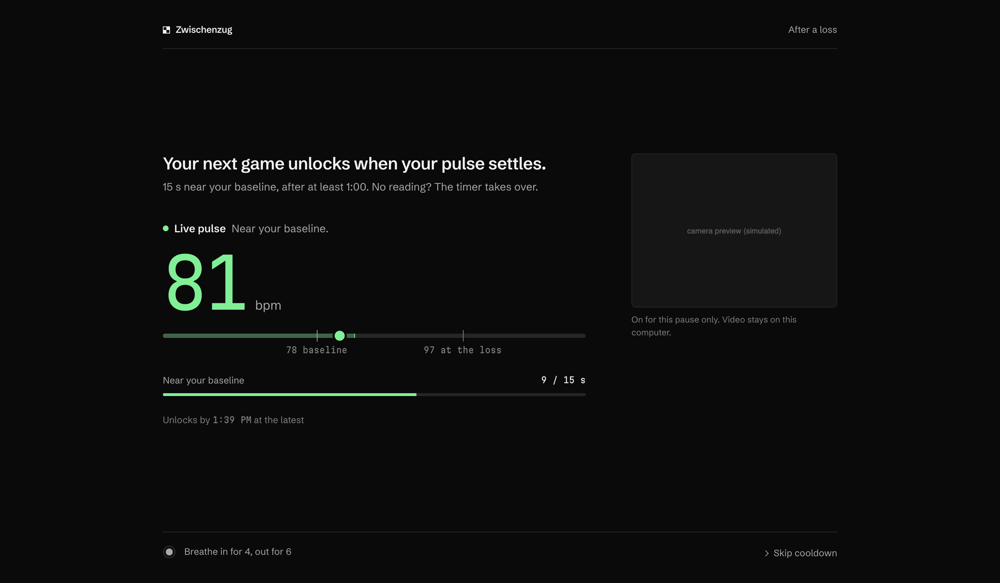

# Zwischenzug

_The in-between move your rating needs._

Zwischenzug is a desktop app for online chess players. You play Lichess inside the app. When
you lose a game, Zwischenzug locks new games until you have settled: with your consent, it
reads your pulse from the webcam (on-device, via the Presage SmartSpectra SDK) and unlocks
once it is back near your own baseline. If there is no usable camera signal, a timer unlocks
instead. You can always skip a cooldown by typing a confirmation sentence.

The camera is **never on while you play**: only during a one-minute check-in and on the
cooldown screen after a loss.

Built for the [DEV.to Presage SmartSpectra SDK Challenge 2026](https://dev.to/challenges/presage-2026-11-04).

> Zwischenzug is a habit tool, not a medical device. It does not diagnose, treat or monitor
> any condition, and it does not claim to detect "tilt". It only compares your current
> pulse reading with your own baseline.



The cooldown screen shows one status line, one big number and one progress bar. **Live pulse**
(green) shows your bpm against your band; **Timer** shows the countdown and the plain reason
(timer only, no baseline, no API key, no face, too dark). More in
[docs/screenshots/](docs/screenshots/):

| Screen              | File                                                                                                                               |
| ------------------- | ---------------------------------------------------------------------------------------------------------------------------------- |
| Consent             | [consent.png](docs/screenshots/consent.png)                                                                                        |
| Lichess account     | [setup.png](docs/screenshots/setup.png)                                                                                            |
| Check-in            | [calibration.png](docs/screenshots/calibration.png)                                                                                |
| Cooldown (pulse)    | [cooldown-pulse.png](docs/screenshots/cooldown-pulse.png), [cooldown-waiting.png](docs/screenshots/cooldown-waiting.png)           |
| Cooldown (timer)    | [cooldown-no-face.png](docs/screenshots/cooldown-no-face.png), [cooldown-timer-only.png](docs/screenshots/cooldown-timer-only.png) |
| Side panel          | [panel.png](docs/screenshots/panel.png), [panel-settings.png](docs/screenshots/panel-settings.png)                                 |
| Sign-in bar         | [panel-signed-out.png](docs/screenshots/panel-signed-out.png)                                                                      |
| Lichess unreachable | [lichess-offline.png](docs/screenshots/lichess-offline.png)                                                                        |
| Diagnostics         | [diagnostics.png](docs/screenshots/diagnostics.png)                                                                                |

The pulse-path cooldowns, `panel.png` and `panel-settings.png` are **simulated**: real
renderer views fed crafted app states, with a placeholder camera image. The others are
scripted smoke runs of the app with a temporary profile. The Lichess area is empty in all of
them because the embedded lichess.org view is captured separately.

## Status

See [docs/IMPLEMENTATION_PLAN.md](docs/IMPLEMENTATION_PLAN.md) for milestone status and
[ARCHITECTURE.md](ARCHITECTURE.md) for design, security model and what is verified.

Short version: the app shell, consent, Lichess loss detection, the lock, the cooldown engine,
the timer fallback, the override, the game log, delete-all and restart persistence are
implemented and verified (unit tests plus scripted runs against live lichess.org). The Presage
SDK **loads and binds** on macOS Apple Silicon and rejects a bad key as expected, but **live
pulse measurement has not been verified** yet because it needs a real Presage API key and a
camera session. [docs/MANUAL_TESTS.md](docs/MANUAL_TESTS.md) has the steps.

## Requirements

- macOS on Apple Silicon (the only platform tested; the SDK also supports Linux x64/arm64 with
  glibc >= 2.35 and Windows x64)
- Node.js >= 22.12 (developed with Node 26, npm 11)
- A webcam and a Presage API key (optional: without one, cooldowns use the timer)
- A Lichess account

## Setup

```bash
git clone <this repo> zwischenzug && cd zwischenzug
npm install
cp .env.example .env    # then put your Presage key in .env (optional, dev only)
npm run app
```

## Run

- **`npm run app`** builds the real app (`release/mac-arm64/Zwischenzug.app`) and opens it.
  This is the user-facing build: named Zwischenzug in the menu bar, Dock, app switcher and
  About panel, with its own icon and a minimal menu (no reload or developer tools). It does not
  read `.env`; paste your Presage key under **Settings** in the side panel once.
- **`npm run dev`** runs from source with the stock Electron binary, for development. The menu
  items say Zwischenzug and a View menu adds Reload and DevTools, but the bold menu-bar title,
  Dock tooltip and app switcher show **Electron**, because they come from Electron's own app
  bundle.

`npm install` downloads the SmartSpectra native runtime for every supported platform (a few
hundred MB). `package.json#allowScripts` approves the install scripts that are needed
(Electron binary download, esbuild, koffi, protobufjs). If your npm skipped the Electron
download, run `node node_modules/electron/install.js`.

If you launch from a VS Code or Cursor integrated terminal, `ELECTRON_RUN_AS_NODE=1` may be set
and Electron will exit immediately. Use `env -u ELECTRON_RUN_AS_NODE npm run dev`.

### Getting a Presage API key

1. Create a free account at <https://physiology.presagetech.com/auth/register> (the link the
   challenge page uses).
2. Copy your API key.
3. Either put it in `.env` as `PRESAGE_API_KEY=...` (development), or paste it into the app
   (**Settings** in the side panel, or the check-in screen). Keys entered in the app are encrypted with the OS keychain
   (Electron `safeStorage`) and stored in the app's data folder. The key is never in source.
   `PRESAGE_API_KEY` wins over a saved key.
4. `npm run presage:check` confirms Presage accepts the key without using the camera (blank
   frames for 20 s; the key is never printed).
5. In the app, **Settings › Advanced › Pulse diagnostics** (or **Troubleshoot** on the
   check-in screen after a failure) shows whether the SDK loaded, whether a key is present,
   the OS camera permission, and a live measurement with raw readings, time to first reading,
   readings per second and the share of stable readings. It says **Presage session running**
   only while a session is actually running, and **Stopped** with the reason otherwise.
   Readings on that screen are not saved.

Note: Presage's sample notes that some keys are not enabled for cardio metrics. Zwischenzug
requests only `PULSE_RATE`. If your key is not provisioned for it, the SDK reports an error,
the app shows it and falls back to the timer.

### First run

1. **Consent**: choose "Allow camera between games" or "Timer only".
2. **Lichess username**: the account whose public game feed is watched.
3. **Check-in** (camera mode): sit as you usually play, light in front of you, one minute.
4. **Play**: sign in to Lichess in the left pane as that account and play normally. Until the
   app has confirmed that the embedded Lichess session is signed in as that account, new games
   are blocked and a bar above Lichess says "Sign in to Lichess as @username to play".
   Browsing and the sign-in page always work. Zwischenzug never sees your Lichess password: it
   asks lichess.org who is signed in, using the embedded session's own cookies.

## Scripts

| Script                            | What it does                                                      |
| --------------------------------- | ----------------------------------------------------------------- |
| `npm run app`                     | Build the packaged app and open it (the user-facing build)        |
| `npm run dev`                     | Build all bundles and launch Electron                             |
| `npm run build`                   | Build `dist/` (main, preload, renderer) with esbuild              |
| `npm start`                       | Launch the last build                                             |
| `npm run typecheck`               | `tsc` for the Node (main/preload/core) and web (renderer) configs |
| `npm run lint`                    | ESLint (typescript-eslint strict + Prettier compatibility)        |
| `npm run format` / `format:check` | Prettier                                                          |
| `npm test`                        | Vitest unit tests                                                 |
| `npm run check`                   | typecheck + lint + format check + tests                           |
| `npm run presage:check`           | Check the Presage key from env/`.env` without a camera            |
| `npm run dist:dir`                | Unsigned unpacked macOS app in `release/`                         |
| `npm run icon`                    | Regenerate `build/icon.png` and `icon.icns` from `build/icon.svg` |
| `npm run dist:mac`                | macOS arm64 DMG (needs signing identity for distribution)         |

## Configuration

Defaults live in [`src/core/config.ts`](src/core/config.ts). Override them with an optional
`zwischenzug.config.json` in the app data folder
(macOS: `~/Library/Application Support/zwischenzug/`), or with environment variables (see
[.env.example](.env.example)). Environment wins over the file.

| Setting                                              | Default                                       | Meaning                                                                                  |
| ---------------------------------------------------- | --------------------------------------------- | ---------------------------------------------------------------------------------------- |
| `cooldown.minWaitSec`                                | 60                                            | No unlock before this, however calm                                                      |
| `cooldown.toleranceBpm` / `tolerancePct`             | 5 / 7                                         | Settled = pulse <= baseline + max(5 bpm, 7%)                                             |
| `cooldown.sustainSec`                                | 15                                            | Settled for this long, with a fresh signal                                               |
| `cooldown.fallbackSec`                               | 180                                           | Timer unlock after this long without a valid reading (from the loss or the last reading) |
| `cooldown.maxSec`                                    | 900                                           | Hard ceiling, never locked longer                                                        |
| `cooldown.escalateAfterLosses` / `suggestedPauseMin` | 5 / 30                                        | Suggest a longer break                                                                   |
| `cooldown.overrideSentence`                          | "I choose to skip this cooldown and play now" | Typed to skip                                                                            |
| `calibration.durationSec` / `minSamples`             | 60 / 10                                       | Check-in length, minimum stable readings                                                 |
| `lichess.pollIntervalSec`                            | 10                                            | Backup polling interval (min 3)                                                          |
| `presage.enableTelemetry`                            | false                                         | SDK aggregate telemetry (upstream default is on)                                         |

## Privacy summary

- **Camera**: used only during the check-in and on the cooldown screen, after explicit consent.
  The app page is the only page allowed to request it (video only). Lichess has no device
  permissions at all.
- **Processing**: on-device by the SmartSpectra SDK. No video or frames are uploaded or saved.
  The SDK contacts Presage to check the API key and usage (seen in its logs: device pairing
  and usage verification). SDK telemetry is disabled.
- **Stored locally** (app data folder): consent choice, Lichess username, baseline pulse, and a
  game log (result, baseline, first pulse reading after the loss, time to unlock, unlock reason).
  Pulse values are not written to the diagnostic log file.
- **Delete**: "Delete all my data" in the side panel removes the game log, baseline, username
  and consent (not available during an active cooldown, so it cannot be used to skip one).
  Your Lichess login cookies live in a separate session folder (`Partitions/lichess`); sign out
  of Lichess or delete that folder to remove them. A saved Presage key is kept; clear it by
  saving an empty key.
- **Network**: lichess.org (the site itself, its public API to detect finished games, and
  `/account/info` with the embedded session's cookies to check who is signed in) and
  Presage's key and usage checks. Nothing else.
- **Export**: "Export CSV" / "Export JSON" in the side panel save the game log (oldest first:
  result, losses in a row, baseline, pulse at loss, time to unlock, unlock reason) to a file
  you choose. Nothing is exported automatically.

## Known limitations

- **Self-control, not enforcement.** You can quit the app, play in a browser, or delete the
  state file. The lock makes the impulsive requeue harder; it cannot make it impossible.
  Changing the system clock while the app runs has no effect, but moving it forward while
  the app is closed (or while the computer sleeps) does shorten a cooldown.
- **SDK start pauses the main process.** Starting a Presage session blocks for about 2-5 s
  (measured with the main-process SDK), so the app can feel briefly unresponsive when the
  check-in, diagnostics or a cooldown starts the camera.
- **Quit waits for the camera session.** Quitting while Presage is measuring waits for the
  native session to shut down (measured up to ~3 s, capped at 10 s); quitting sooner aborts
  the process.
- **Detection latency.** Game end is detected from Lichess's public game stream (sub-second to
  a few seconds). A click on "rematch"/"new opponent" faster than that can still go through.
- **Lichess internals.** The request-blocking layer uses Lichess URL paths and sockets that can
  change without notice. The primary lock (hiding the Lichess view) does not depend on them.
  The sign-in check uses `/account/info`, an endpoint built for Lichess's old mobile app; if
  Lichess removes or changes it, play stays blocked (fail closed) and the bar says why.
- **lichess.org unreachable.** If the Lichess page fails to load (offline, timeout), the app
  shows "Can’t reach lichess.org" with a **Retry now** button and retries after 2 s, 5 s,
  10 s, then every 30 s, and at once when the network comes back. A load that hangs on a very
  slow connection is not cut short; it shows "Retrying…" until Chromium gives up or it loads.
- **Sign-in check latency.** Sign-out and account switches are caught at once (login cookie
  change); a session that expires on the server side is caught within a minute.
- **Pulse measurement unverified here.** Time to first reading, how often readings arrive, and
  how many count as "stable" on a typical laptop webcam still need on-device testing. The
  10-reading calibration minimum is a guess and configurable.
- **Pulse after casual losses may barely rise.** The minimum wait and timer still apply. The
  local log lets you see your own numbers.
- **Dev builds show "Electron" in the menu bar.** The bold app-menu title, Dock tooltip and app
  switcher come from the stock Electron bundle; `npm run app` builds the app named Zwischenzug
  everywhere. A Presage key saved in the app before
  the rename may need saving again (its keychain entry is tied to the app name);
  `PRESAGE_API_KEY` in `.env` is unaffected.
- **Breathing guide is a fixed pace** (in 4, out 6), not a measurement.
- Only Lichess. Chess.com is a planned second `GameSource`.
- Tested on macOS Apple Silicon only.

## Credits

- Presage SmartSpectra SDK (`@smartspectra/node-sdk`), integrated following the official
  Electron quickstart (renderer SDK, SDK preload bridge, `bindSmartSpectraIpc`).
- Lichess public API: <https://lichess.org/api>.
- Fonts, self-hosted under the SIL Open Font License 1.1 (licenses in `src/renderer/fonts/`):
  [Schibsted Grotesk](https://github.com/schibsted/schibsted-grotesk) for text and
  [Martian Mono](https://github.com/evilmartians/mono) for numbers.
- Research basis for the time floors (one minute, 30 minutes after five losses):
  [romanbreyten/chess-tilt](https://github.com/romanbreyten/chess-tilt).

## License

Not yet chosen (`UNLICENSED`). The challenge requires a public repository; pick a license
before publishing.
